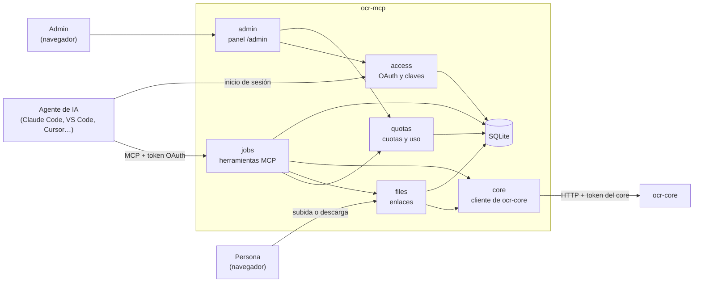
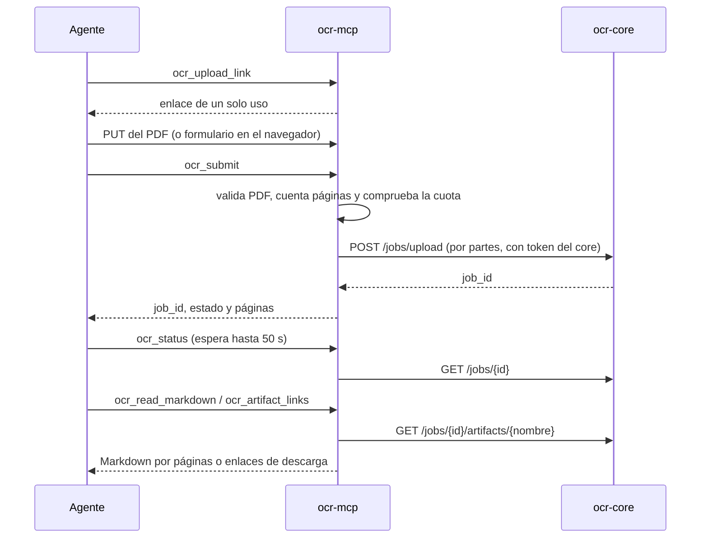

# Arquitectura

> **Aprobada, sin implementar.** Describe el diseño de las decisiones 0001 a
> 0007. Cuando exista el código, cada afirmación se contrasta con él y se
> actualiza en el mismo cambio.

## Resumen

`ocr-mcp` es un servicio HTTP que habla MCP con los agentes de IA y HTTP con
`ocr-core`. Recibe PDF por enlace, crea trabajos en el core, entrega el
Markdown por páginas y los artefactos por enlace. Controla quién lo usa (OAuth
2.1 con una clave por usuario) y cuánto (cuotas), y ofrece un panel mínimo de
admin. No hace OCR y no conoce el almacenamiento de ningún otro sistema.

## Stack previsto

| Pieza | Elección | Por qué |
| --- | --- | --- |
| Lenguaje | Python 3.11 o posterior | El SDK oficial de MCP y el resto del ecosistema del core |
| Servidor MCP y OAuth | SDK oficial `mcp` (Streamable HTTP y servidor de autorización) | Sigue la especificación sin reimplementarla |
| Cliente del core | `httpx` | Subida y descarga por partes, asíncronas |
| PDF | `pypdf` | Validar el archivo y contar páginas antes de subir |
| Plantillas del panel y del inicio de sesión | `jinja2` | Escape automático del HTML |
| Estado | SQLite de la biblioteca estándar | Un solo archivo, sin servidor ni ORM |

## Componentes y fronteras



| Componente | Responsabilidad | Frontera |
| --- | --- | --- |
| `access` | Servidor de autorización incluido, claves de acceso y página de inicio de sesión | Única fuente de identidad del usuario |
| `jobs` | Herramientas MCP, dueño de cada trabajo y Markdown por páginas | Habla con el core solo a través de `core` |
| `files` | Enlaces de subida y descarga, y URL de prefijos permitidos | Nunca lee ni escribe rutas del disco en nombre de un usuario |
| `quotas` | Cuotas por clave, modo público y estadísticas | Solo conteos, nunca nombres ni contenido |
| `admin` | Panel `/admin`: claves, cuotas, uso, modo público y ejemplos | Credenciales del admin desde el entorno |
| `core` | Cliente de `ocr-core`: token, `/meta`, subida, estado, artefactos y borrado | El único que conoce la API del core |

## Capas y dirección de dependencias

- `app.py` compone el servicio y es el único que conoce a todos los módulos.
- Un módulo usa a otro solo por su interfaz pública (`__init__.py` del
  módulo), nunca por sus archivos internos.
- `shared/` (base de datos, seguridad y utilidades web) no depende de ningún
  módulo.
- `config.py` lee y valida el entorno al arrancar; los módulos reciben su
  configuración, no leen variables por su cuenta.

## Mapa de carpetas previsto

```text
src/ocr_mcp/
├── __main__.py      arranque
├── app.py           composición del servicio
├── config.py        entorno validado al arrancar
├── shared/          db.py, security.py, web.py
├── migrations/      SQL numerado
└── modules/
    ├── core/        cliente de ocr-core
    ├── access/      OAuth, claves e inicio de sesión
    ├── files/       enlaces de subida y descarga
    ├── jobs/        herramientas MCP
    ├── quotas/      cuotas, modo público y estadísticas
    └── admin/       panel /admin
tests/               mismo orden que modules/, más el core simulado
```

## Flujo global



## Decisiones transversales

Las restricciones que gobiernan esta arquitectura están en
`docs/decisiones/README.md`: alcance (0001), transporte y OAuth (0002),
archivos (0003), trabajo asíncrono (0004), límites (0005), acceso y panel
(0006) y cuotas (0007).
