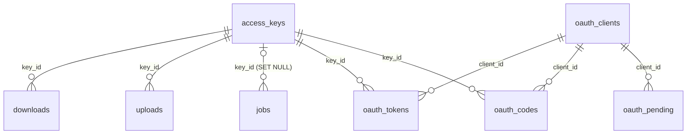

# Modelo de datos

Fuente normativa de la persistencia de `ocr-mcp`. El origen canónico es
`src/ocr_mcp/migrations/` (SQL numerado, aplicado al arrancar por
`src/ocr_mcp/shared/db.py`); este documento explica su significado.

> El validador de memoria no lee migraciones SQL: este documento se revisa a
> mano contra ellas.

## Alcance de persistencia

| Almacén | Contenido | Fuera de alcance |
| --- | --- | --- |
| SQLite en `<OCR_MCP_DATA_DIR>/ocr-mcp.sqlite3` (WAL, claves foráneas activas) | Claves, OAuth, trabajos, enlaces, sesiones del admin, límites de intentos y configuración | Documentos y artefactos: viven en el core |
| `<OCR_MCP_DATA_DIR>/uploads/<id>.pdf` | El PDF de una subida `ready`, hasta enviarlo al core | Cualquier otro archivo |

**Privacidad:** claves, tokens, códigos, pedidos, enlaces y sesiones se guardan
solo como SHA-256 (`*_hash`); las direcciones de los límites de intentos,
también. No se guardan nombres de archivo, títulos ni contenido de documentos
(decisiones 0006 y 0007).

## Diagrama global de relaciones

`admin_sessions`, `rate_limits`, `settings` y `schema_migrations` no se
relacionan con otras tablas.

## Inventario de entidades

| Entidad | Tabla | Propósito | Módulo |
| --- | --- | --- | --- |
| Clave de acceso | `access_keys` | Identidad de un usuario y su cuota | `access` |
| Cliente OAuth | `oauth_clients` | Cliente registrado dinámicamente (JSON del SDK) | `access` |
| Pedido pendiente | `oauth_pending` | Autorización que espera la clave (10 min) | `access` |
| Código de autorización | `oauth_codes` | Código de un solo uso (5 min) | `access` |
| Token | `oauth_tokens` | Token de acceso o de refresco | `access` |
| Trabajo | `jobs` | Trabajo del core creado por este servidor: dueño, conteos y estado | `jobs` |
| Subida | `uploads` | Enlace de subida y el PDF que recibió | `files` |
| Descarga | `downloads` | Enlace de descarga de un artefacto | `files` |
| Sesión del admin | `admin_sessions` | Sesión del panel con su token CSRF | `admin` |
| Intento | `rate_limits` | Ventana deslizante de intentos por dirección | `shared` |
| Ajuste | `settings` | Configuración guardada (hoy, el modo público) | `quotas` |

## Campos

### `access_keys`

| Campo | Tipo | Null | Significado |
| --- | --- | --- | --- |
| `id` | TEXT, PK | No | Identificador; es el `subject` de los tokens |
| `name` | TEXT | No | Nombre para reconocerla (hasta 80 caracteres) |
| `key_hash` | TEXT, UNIQUE | No | SHA-256 de la clave `ocrk_…` |
| `is_public` | INTEGER 0/1 | No | Obtenida en el modo público |
| `pages_per_day`, `pages_per_month`, `max_active_jobs` | INTEGER > 0 | Sí | Cuota; `NULL` es sin límite propio |
| `created_at`, `last_used_at` | REAL (epoch) | `last_used_at` sí | Alta y último token validado |

### `oauth_clients`, `oauth_pending`, `oauth_codes` y `oauth_tokens`

| Tabla | Clave | Campos propios |
| --- | --- | --- |
| `oauth_clients` | `client_id` | `info` (JSON del registro), `created_at` |
| `oauth_pending` | `request_hash` | `client_id`, `params` (JSON del pedido), `expires_at` |
| `oauth_codes` | `code_hash` | `client_id`, `key_id`, `params`, `expires_at` |
| `oauth_tokens` | `token_hash` | `kind` (`access` o `refresh`), `client_id`, `key_id`, `scopes` (JSON), `resource` (siempre `<URL>/mcp`), `expires_at`, `created_at` |

### `jobs`

| Campo | Tipo | Null | Significado |
| --- | --- | --- | --- |
| `job_id` | TEXT, PK | No | Identificador del trabajo en el core |
| `key_id` | TEXT | Sí | Dueño; `NULL` si la clave se borró |
| `request_hash` | TEXT, UNIQUE | No | Huella del pedido; un reenvío idéntico reutiliza el trabajo. Al fallar, se libera agregándole `:<job_id>` |
| `is_public` | INTEGER 0/1 | No | Copia de la clave, para el tope global aunque la clave se borre |
| `pages`, `bytes` | INTEGER > 0 | No | Tamaño del documento |
| `artifacts` | TEXT (JSON) | No | Artefactos pedidos |
| `status` | TEXT | No | `queued`, `processing`, `done`, `failed` o `blocked` |
| `refunded` | INTEGER 0/1 | No | 1 si el trabajo falló y sus páginas volvieron a la cuota |
| `created_at`, `finished_at` | REAL | `finished_at` sí | Envío y fin |

### `uploads` y `downloads`

| Tabla | Clave | Campos propios |
| --- | --- | --- |
| `uploads` | `id` | `token_hash` (UNIQUE), `key_id`, `state` (`waiting`, `ready` o `used`), `bytes`, `pages`, `sha256` (del PDF), `expires_at`, `created_at` |
| `downloads` | `token_hash` | `key_id`, `job_id`, `artifact` (`pdf`, `text` o `md`), `expires_at` |

### Tablas sin relaciones

| Tabla | Campos |
| --- | --- |
| `admin_sessions` | `token_hash` (PK), `csrf`, `expires_at` |
| `rate_limits` | `bucket` (`login`, `admin-login` o `public-key`, este compartido por `/login/public` y `/public/key`), `subject` (hash de la dirección), `at` |
| `settings` | `name` (PK), `value` (JSON) |
| `schema_migrations` | `name` (PK), `applied_at` |

## Relaciones y cascadas

| Relación | Al borrar el padre |
| --- | --- |
| `access_keys` → `oauth_codes`, `oauth_tokens`, `uploads`, `downloads` | `CASCADE`: borrar la clave revoca su acceso de inmediato |
| `access_keys` → `jobs` | `SET NULL`: nadie ve los trabajos, pero se conservan los conteos |
| `oauth_clients` → `oauth_pending`, `oauth_codes`, `oauth_tokens` | `CASCADE` |

## Accesos e índices

| Consulta | Índice |
| --- | --- |
| Uso de una clave por periodo | `jobs_by_key (key_id, created_at)` |
| Páginas públicas del día | `jobs_public_by_day (is_public, created_at)` |
| Tokens de una clave | `oauth_tokens_by_key (key_id)` |
| Intentos en la ventana | `rate_limits_lookup (bucket, subject, at)` |

## Reglas transversales

| Regla | Implementación | Prueba |
| --- | --- | --- |
| Secretos solo como hash | Aplicación (`shared/security.py`) | `tests/shared/test_shared.py` |
| Sin nombres ni contenido de documentos | Esquema de `jobs` | `test_usage_keeps_counts_but_never_titles_or_file_names` |
| Limpieza de vencidos | Al crear tokens, enlaces y sesiones, y al arrancar | — |

## Historial de cambios de esquema

| Cambio | Migración | Estado |
| --- | --- | --- |
| Esquema inicial | `001_inicial.sql` | Aplicada por las pruebas |
