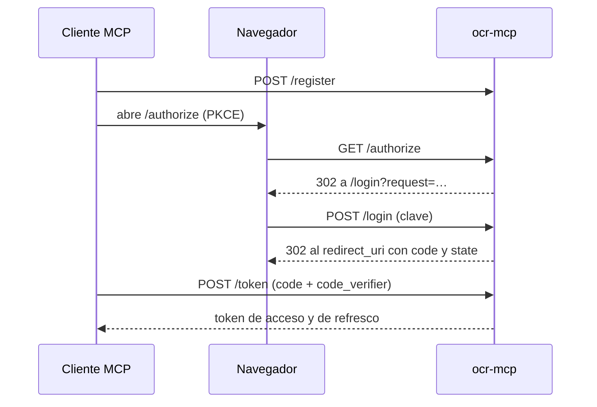

# Contexto: `access`

## Propósito

Decide quién usa el servidor: claves de acceso por usuario y un servidor de
autorización OAuth 2.1 incluido (decisiones 0002 y 0006).

## Alcance y límites

- Incluye: claves (`keys.py`), el proveedor OAuth que usa el SDK de MCP
  (`oauth.py`) y la página donde el usuario pega su clave (`login.py`).
- No incluye: las rutas `/authorize`, `/token`, `/register` y `/revoke` y los
  metadatos, que monta el SDK con este proveedor.
- Dependencias funcionales: `quotas` (límites de una clave y modo público).

## Vocabulario

| Término | Significado | No confundir con |
| --- | --- | --- |
| Clave de acceso | Secreto `ocrk_…` que identifica a un usuario | El token OAuth, que la clave permite obtener |
| Pedido pendiente | Autorización que espera la clave (10 min) | El código de autorización (5 min, un solo uso) |
| `subject` | Identificador de la clave en códigos y tokens | El `client_id` del cliente MCP |

## Actores y permisos

| Actor | Puede | No puede | Evidencia |
| --- | --- | --- | --- |
| Cliente MCP | Registrarse, pedir autorización y canjear o refrescar tokens | Obtener tokens sin una clave válida | `tests/modules/access/test_oauth_flow.py` |
| Usuario | Pegar su clave y volver a su cliente | Saber si una clave ajena existe | `test_the_key_page_rejects_with_a_generic_message` |
| Cualquiera (modo público) | Obtener una clave con la cuota pública | Obtener más claves que el límite por dirección | `test_public_mode_hands_out_limited_keys` |

## Estados y transiciones

| Origen | Evento | Destino |
| --- | --- | --- |
| — | El cliente pide `/authorize` | Pedido pendiente |
| Pedido pendiente | El usuario pega una clave válida | Código de autorización |
| Código | El cliente lo canjea con PKCE | Token de acceso y de refresco (el código desaparece) |
| Token de refresco | El cliente lo usa | Par nuevo (el usado deja de valer) |
| Cualquiera | El admin borra la clave | Revocado en cascada |

## Reglas

1. La clave se muestra una sola vez y se guarda solo como hash; la búsqueda es
   por hash. Prueba: `test_creating_a_key_shows_it_once_with_client_examples`.
2. Una clave inválida recibe siempre "La clave no es válida." (`401`); diez
   intentos por dirección en diez minutos bloquean con `429`.
3. El código es de un solo uso. Prueba: `test_the_code_works_only_once`.
4. Todo token se emite para el recurso `<OCR_MCP_PUBLIC_URL>/mcp` y lleva como
   `subject` el identificador de la clave. Prueba:
   `test_a_valid_key_obtains_tokens_bound_to_its_user`.
5. El refresco rota el par. Prueba:
   `test_refresh_rotates_and_the_old_refresh_token_stops_working`.
6. Borrar la clave revoca de inmediato sus códigos y tokens (cascada en la
   base). Prueba: `test_deleting_the_key_revokes_its_tokens_at_once`.
7. Las claves públicas nacen con la cuota pública y respetan el límite diario
   por dirección.

## Flujo e integraciones

## Errores esperables y recuperación

| Situación | Comportamiento | Recuperación |
| --- | --- | --- |
| Pedido vencido o inexistente | Página "Pedido vencido" (`400`) | Volver a conectar desde el cliente |
| Clave borrada | `401` en `/mcp`; las herramientas piden reconectar | Pedir otra clave al admin |

## Pruebas mínimas

`tests/modules/access/test_oauth_flow.py`, incluida una sesión MCP real con el
token (`test_a_valid_token_reaches_the_mcp_endpoint`).
