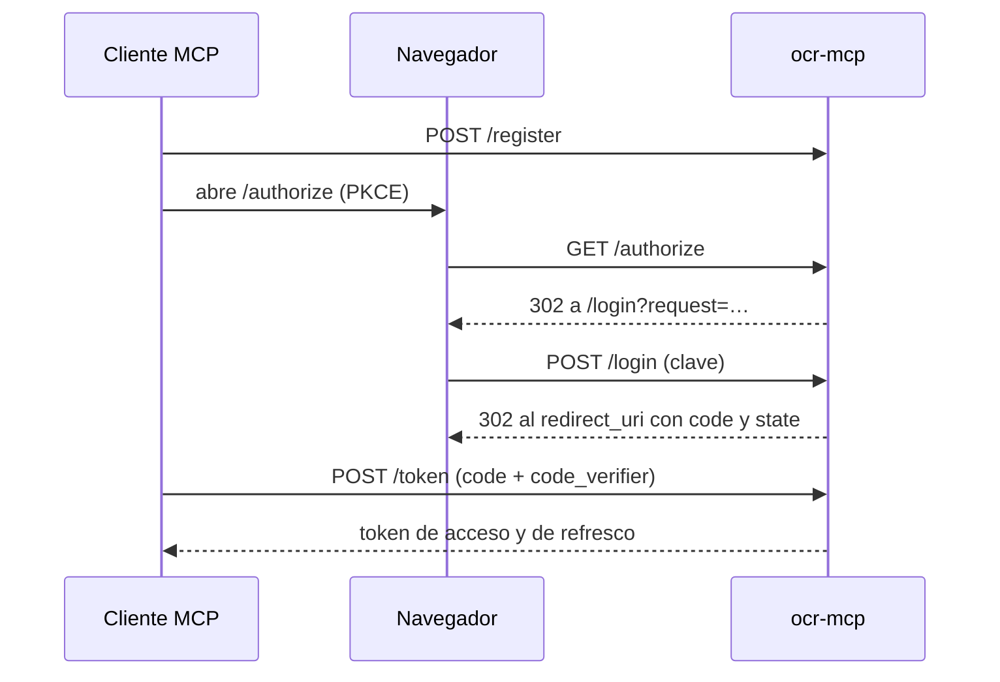

# Contexto: `access`

## Propósito

Decide quién usa el servidor: claves de acceso por usuario, que se usan con un
servidor de autorización OAuth 2.1 incluido o directamente como token Bearer, y
claves públicas autoservicio en modo público (decisiones 0002, 0006, 0007 y
0009).

## Alcance y límites

- Incluye: claves (`keys.py`), el proveedor OAuth que usa el SDK de MCP
  (`oauth.py`, que también acepta la clave como token), la página donde el
  usuario pega su clave (`login.py`) y la emisión de claves públicas con
  `/public/key` (`public_keys.py`).
- No incluye: las rutas `/authorize`, `/token`, `/register` y `/revoke` y los
  metadatos, que monta el SDK con este proveedor.
- Dependencias funcionales: `quotas` (límites de una clave y modo público).

## Vocabulario

| Término | Significado | No confundir con |
| --- | --- | --- |
| Clave de acceso | Secreto `ocrk_…` que identifica a un usuario; vale también como token Bearer | El token OAuth, que la clave permite obtener y que vence solo |
| Clave como token | La clave en `Authorization: Bearer` de `/mcp`, sin OAuth | Un token OAuth (sin prefijo `ocrk_`) |
| Pedido pendiente | Autorización que espera la clave (10 min) | El código de autorización (5 min, un solo uso) |
| `subject` | Identificador de la clave en códigos y tokens | El `client_id` del cliente MCP |

## Actores y permisos

| Actor | Puede | No puede | Evidencia |
| --- | --- | --- | --- |
| Cliente MCP | Registrarse, pedir autorización y canjear o refrescar tokens | Obtener tokens sin una clave válida | `tests/modules/access/test_oauth_flow.py` |
| Usuario | Pegar su clave y volver a su cliente | Saber si una clave ajena existe | `test_the_key_page_rejects_with_a_generic_message` |
| Cliente sin OAuth | Usar `/mcp` con la clave como token | Usar una clave borrada o inventada | `tests/modules/access/test_key_as_token.py` |
| Cualquiera (modo público) | Obtener una clave con la cuota pública, en la página de inicio de sesión o en `/public/key` | Obtener más claves que el límite por dirección, sumando las dos vías | `test_public_mode_hands_out_limited_keys`, `tests/modules/access/test_public_keys.py` |

## Estados y transiciones

| Origen | Evento | Destino |
| --- | --- | --- |
| — | El cliente pide `/authorize` | Pedido pendiente |
| Pedido pendiente | El usuario pega una clave válida | Código de autorización |
| Código | El cliente lo canjea con PKCE | Token de acceso y de refresco (el código desaparece) |
| Token de refresco | El cliente lo usa | Par nuevo (el usado deja de valer) |
| Cualquiera | El admin borra la clave | Revocado en cascada; la clave deja de valer como token |

## Reglas

1. La clave se muestra una sola vez y se guarda solo como hash; la búsqueda es
   por hash. Prueba: `test_creating_a_key_shows_it_once_with_client_examples`.
2. Una clave inválida recibe siempre "La clave no es válida." (`401`); diez
   intentos por dirección en diez minutos bloquean con `429`.
3. El código es de un solo uso. Prueba: `test_the_code_works_only_once`.
4. Todo token se emite para el recurso `<OCR_MCP_PUBLIC_URL>/mcp` y lleva como
   `subject` el identificador de la clave. Prueba:
   `test_a_valid_key_obtains_tokens_bound_to_its_user`.
5. El refresco rota el par. Prueba:
   `test_refresh_rotates_and_the_old_refresh_token_stops_working`.
6. Borrar la clave revoca de inmediato sus códigos y tokens (cascada en la
   base). Prueba: `test_deleting_the_key_revokes_its_tokens_at_once`.
7. Las claves públicas nacen con la cuota pública y respetan el límite diario
   por dirección, compartido entre `/login/public` y `/public/key`. Prueba:
   `test_the_daily_limit_per_address_is_shared_with_the_login_page`.
8. Una clave válida vale como token Bearer en `/mcp`: identifica a su usuario
   (`subject`), para el recurso `<OCR_MCP_PUBLIC_URL>/mcp` y con el alcance
   `ocr`, sin vencimiento propio. Borrada o inventada, `/mcp` responde `401`.
   Pruebas: `test_the_key_token_identifies_its_user_for_this_resource` y
   `test_an_unknown_or_deleted_key_is_rejected`.
9. `POST /public/key` responde en HTML si el `Accept` incluye `text/html` y en
   JSON en cualquier otro caso, siempre sin caché. Pruebas:
   `test_a_script_gets_a_public_key_as_json` y
   `test_a_browser_gets_the_page_and_the_key_with_client_examples`.
10. La dirección del cliente es la que ve uvicorn: detrás de un proxy, solo es
    la real si el proxy figura en `OCR_MCP_TRUSTED_PROXIES` (decisión 0009).

## Flujo e integraciones



Sin OAuth, con la clave como token:

```mermaid
sequenceDiagram
    participant A as Agente o script
    participant S as ocr-mcp
    A->>S: POST /public/key (modo público; o la clave del admin)
    S-->>A: {"key": "ocrk_…", "mcp_url", "header", "limits"}
    A->>S: /mcp con Authorization: Bearer ocrk_…
    S-->>A: sesión MCP a nombre de esa clave
```

## Errores esperables y recuperación

| Situación | Comportamiento | Recuperación |
| --- | --- | --- |
| Pedido vencido o inexistente | Página "Pedido vencido" (`400`) | Volver a conectar desde el cliente |
| Clave borrada | `401` en `/mcp`; las herramientas piden reconectar | Pedir otra clave al admin |
| Modo público apagado | `/public/key` y `/login/public` responden `404` | Pedir una clave al admin |
| Claves públicas del día agotadas | `429` con "Ya obtuviste las claves públicas permitidas por hoy." | Esperar al día siguiente; detrás de un proxy, revisar `OCR_MCP_TRUSTED_PROXIES` |

## Pruebas mínimas

`tests/modules/access/test_oauth_flow.py`, incluida una sesión MCP real con el
token (`test_a_valid_token_reaches_the_mcp_endpoint`);
`tests/modules/access/test_key_as_token.py` (sesión MCP con la clave como
token) y `tests/modules/access/test_public_keys.py`.
